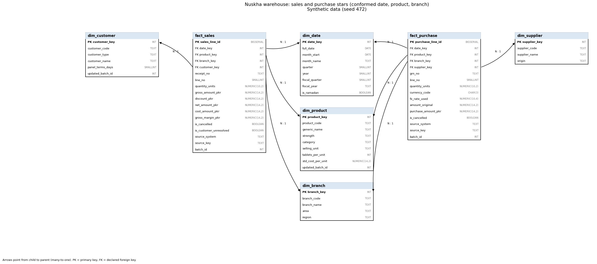
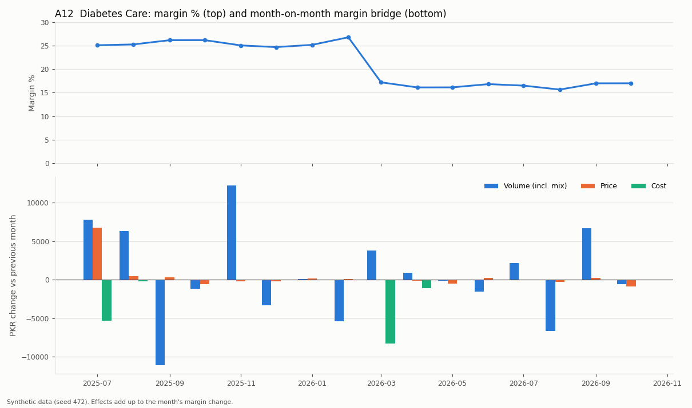
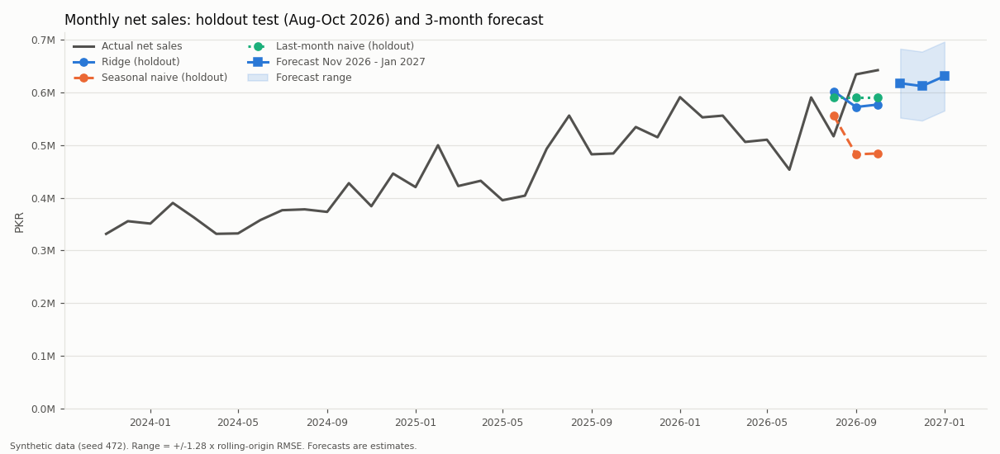

# Nuskha Pharmacies: an integrated data warehouse, BI report and AI layer

CT-472 Data Warehousing and Business Intelligence · Semester project · November 2026

All data in this project is synthetic, produced by one seeded generator (seed 472). It contains no patient data and no real brands or companies.

## 1. Problem, scenario and business questions

Nuskha Pharmacies is a fictional chain of 10 pharmacies in Karachi, in three regions: North (North Nazimabad, Gulberg, Nazimabad, Orangi), East (Gulshan-e-Iqbal, Gulistan-e-Jauhar, Malir) and South (Clifton, Saddar, PECHS). It sells about 150 medicines and health products in 8 categories, buys from 25 local and importing distributors, and pays for some product lines in US dollars. Its fiscal year runs July to June.

The chain's records sit in four departmental systems on three database engines, and none of them agree on how a branch, a product or a customer is named. Sales spells each branch two or three ways, Purchasing identifies products by vendor code and Sales by till code, and imported purchases are priced in USD. A question such as "why did Diabetes Care margin fall?" needs the selling price from Sales, the cost from Purchasing and Inventory, and the exchange rate from Finance. Answering it by hand across three engines and two currencies is not practical. The warehouse puts all four systems on one product, branch and customer identity and keeps 36 months (Nov 2023 – Oct 2026) under one definition.

Six business questions drove the design:

| # | Type | Question | User | Grain | Decision |
| --- | --- | --- | --- | --- | --- |
| BQ1 | Comparison | Which branches grew net sales and margin vs the same quarter last year? | Operations Director | Branch × fiscal quarter | Move stock and pharmacists |
| BQ2 | Trend | How do monthly sales move through the flu, dengue and Ramadan seasons? | CEO | Category × month | Plan seasonal stock |
| BQ3 | Contribution | Which products make up 80% of gross margin? | Category Manager | Product × fiscal year | Negotiate terms, trim the range |
| BQ4 | Diagnosis | Why did Diabetes Care margin fall in 2026: price, cost or mix? | Finance Controller | Product × month | Renegotiate or switch supplier |
| BQ5 | Forecast | What will company net sales be in each of the next three months? | Procurement Head, Finance | Company × month | Purchase budget and cash plan |
| BQ6 | Anomaly | Which region-category months moved abnormally? | Internal Audit, Pharmacy Ops | Region × category × month | Investigate outbreak, theft, stock-out or keying error |

## 2. Sources, generator and planning matrix

Four of Nuskha's ten departments are implemented as source systems. The other six (Pharmacy Operations, Marketing and Loyalty, Home Delivery, Customer Care, HR, IT) are planned, and the bus matrix in section 4 shows where they would join without a redesign.

| Department | Engine and database | Main tables | Feeds |
| --- | --- | --- | --- |
| Sales (till) | MySQL 9.3, `sales_db` | receipt, receipt_line, loyalty_member, pos_item | fact_sales, dim_customer, dim_branch |
| Purchasing | PostgreSQL 18, `purchasing_db` | supplier, purchase_order, goods_receipt, grn_line, vendor_item | fact_purchase, dim_supplier |
| Inventory | SQLite 3, `inventory.db` | item, store, item_cost_history, stock_count | dim_product, dim_branch, standard cost |
| Finance | MySQL 9.3, `finance_db` (separate database) | panel_account, fx_rate, panel_invoice | dim_customer, USD→PKR conversion |

One generator (`src/generate_sources.py`) writes both source snapshots from seed 472, and running it twice gives byte-identical files. Loading the sources twice gives identical checksums on all 17 tables (`evidence/01_sources/reproducibility.csv`). Stage 1 (up to 31 Aug 2026) holds 12,767 receipts with 28,099 lines and 1,717 goods receipts with 4,683 lines. Stage 2 (up to 31 Oct 2026) holds 13,833 receipts with 30,417 lines and 5,002 GRN lines, and adds corrections, voids, cancellations, 40 late receipts, 3 deleted receipts and one new product (`evidence/01_sources/stage2_row_counts.csv`, `stage2_intended_changes.csv`).

The generator plants patterns for the analysis to find: about 1% monthly growth plus an 8% price rise every July; Cough and Cold peaking in December–February and Analgesics and Gastro in August–October; a 12% Diabetes Care cost rise from 1 March 2026 with shelf prices frozen; an East Analgesics spike in September 2026, a one-branch stock-out (Gulshan-e-Iqbal, June 2026) and one keying error (quantity 80 instead of 8). It also plants defects with known keys: unknown products (R01), bad quantities (R02), bad dates (R03), bad amounts (R04), unknown branches (R05), missing exchange rates (R06), orphan lines (R07), exact duplicates (D01), unresolved panel customers (U01) and legitimate repeats that must be kept. Each one is listed in a defect ledger (`evidence/01_sources/defect_ledger.csv`), so the ETL can be checked key by key rather than by eye. The source ERDs are drawn from the DDL in `evidence/01_sources/erd/`.

## 3. Architecture and ETL

Data moves one way through seven layers, run in order by one notebook (`pipeline.ipynb`, which calls `src/pipeline.py`):

1. **Sources:** MySQL, PostgreSQL and SQLite, loaded from the generated snapshots.
2. **Raw snapshots:** every extract is saved unchanged as text CSV per table per batch (`evidence/02_etl/raw/batch_<n>/`) and never edited.
3. **Staging (`stg`):** typed, normalized copies. Dates are parsed, category and branch text is trimmed and standardized, boxes are converted to selling units, money is stored as NUMERIC(14,2), and USD is converted to PKR at the Finance rate on or before the receipt date.
4. **Integration:** the crosswalks `xw_product`, `xw_branch` and `xw_customer` map every source code to one canonical member and record how each match was made (exact, rule, alias list or manual).
5. **Warehouse (`dw`):** two star schemas in PostgreSQL, plus `etl` (batches, rejects, logs), `meta` (metadata, lineage) and `ai` (model outputs).
6. **Analytics views:** six saved SQL views feed both Power BI and the AI code.
7. **Consumers:** the Power BI report (3 pages) and the forecast and anomaly models, which write their results back to `ai`.

Transaction tables are extracted by watermark on `updated_at`, which is stored in `etl.batch`. Master tables are small, so they are extracted in full every batch. Every step writes a CSV log to its evidence folder and a row to `etl.batch_stage_log`. Before- and after-cleaning profiles (null counts, distinct spellings, unit mix, date ranges) are saved side by side in `evidence/02_etl/profile_before_after.csv`.

Crosswalks resolved 150 Inventory items, 152 vendor codes and 153 till codes. 105 vendor codes matched exactly and 45 by description; 114 till codes matched exactly, 14 by rule and 22 by description. The unmatched codes (2 vendor, 3 till) are exactly the planted R01 codes (`evidence/02_etl/crosswalk_match_methods.csv`). Pre-join checks confirm that every source key is unique and every crosswalk is many-to-one, and they count rows before and after each join so that no join can multiply rows (`evidence/02_etl/prejoin_checks.csv`, `join_log.csv`).

**Reconciliation.** For every table and batch, source rows = loaded + rejected + duplicates removed, and amounts are compared month by month to the paisa:

| Batch | Table | Source rows | Loaded | Rejected | Duplicates | Balanced |
| --- | --- | --- | --- | --- | --- | --- |
| 1 | sales_db.receipt_line | 28,238 | 27,543 | 556 | 139 | yes |
| 1 | purchasing_db.grn_line | 4,706 | 4,604 | 79 | 23 | yes |
| 2 | sales_db.receipt_line | 2,428 | 2,369 | 47 | 12 | yes |
| 2 | purchasing_db.grn_line | 328 | 321 | 5 | 2 | yes |

Source: `evidence/02_etl/reconciliation_batch_1.csv`, `reconciliation_batch_2.csv`. Batch 1 sent 635 rows to `etl.rejects`, and every reason code equals the defect ledger key for key (`evidence/02_etl/rejects_vs_ledger.csv`). The 278 legitimate repeats were kept and only the 162 exact duplicates were removed.

## 4. Dimensional design

Selling and buying the same products are two related processes, modelled as two stars that share the Date, Product and Branch dimensions.

**Grains.** `dw.fact_sales` has one row per till receipt line, with natural key (source_system, receipt_no, line_no). `dw.fact_purchase` has one row per goods-receipt line, with natural key (source_system, grn_no, line_no). Sales measures are quantity_units, gross_amount_pkr, discount_pkr, net_amount_pkr, cost_amount_pkr (quantity × Inventory standard cost on the receipt date) and gross_margin_pkr, all additive. Purchase measures are quantity_units, amount_original (additive within one currency only) and purchase_amount_pkr. Ratios (ASP, unit cost, margin %) are non-additive and are always recomputed from sums in the views.

**Dimensions.** `dim_date` is conformed, with calendar and July–June fiscal hierarchies and a Ramadan flag. `dim_product` (SKU → generic → category) and `dim_branch` (branch → area → region) are also conformed. `dim_customer` (walk-in, loyalty, panel) belongs to Sales only, and `dim_supplier` (local or import) to Purchasing only. Every dimension has an Unknown member (key −1), and `dim_customer` also has a Walk-in member (key 0). Fact foreign keys are never null. Surrogate keys are assigned once and never change. SCD Type 1 applies to `dim_product` and `dim_customer`.

**Bus matrix and source coverage.**

| Process | Date | Product | Branch | Customer | Supplier | Status |
| --- | --- | --- | --- | --- | --- | --- |
| Sales | ✓ | ✓ | ✓ | ✓ |  | Built |
| Purchasing | ✓ | ✓ | ✓ |  | ✓ | Built |
| Stock snapshot | ✓ | ✓ | ✓ |  |  | Planned |
| Returns | ✓ | ✓ | ✓ | ✓ |  | Planned |
| Home delivery | ✓ |  | ✓ | ✓ |  | Planned |

| Department | fact_sales | fact_purchase | dim_product | dim_branch | dim_customer | dim_supplier |
| --- | --- | --- | --- | --- | --- | --- |
| Sales | rows, measures |  | till codes | branch text | loyalty, panel text |  |
| Purchasing |  | rows, measures | vendor codes | branch_id |  | all |
| Inventory | cost_amount_pkr |  | master attributes | master attributes |  |  |
| Finance |  | FX rate |  |  | panel accounts |  |

Four departments feed the two stars (the requirement is three). The full warehouse DDL is in Appendix A. It was tested on an empty database, run twice (`evidence/03_warehouse/ddl_empty_database_test.csv`).

## 5. Data quality, batches, rerun, failure recovery and SCD

**Rejects and duplicates.** Invalid rows go to `etl.rejects` with source system, table, source key, one reason code (applied in a fixed order of precedence), reason text and batch id. Unresolvable panel customers are loaded against the Unknown customer and flagged rather than rejected. Appendix D gives the reject summary by reason.

**Rerun.** Loading batch 1 again on unchanged input wrote 0 rows and left every total and table fingerprint unchanged (`evidence/03_warehouse/rerun_checks.csv`). This works because loads are upserts (`INSERT … ON CONFLICT DO UPDATE … WHERE … IS DISTINCT FROM`) on natural keys.

**Batch 2** was extracted from the batch-1 watermark (2026-08-31 23:59:59). It updated 71 stage-1 lines in place (quantity fixes, panel-name fixes and voids) and left 21 re-saved but unchanged lines untouched. It flagged 31 voided lines as cancelled (kept, not deleted, and excluded from every view) and 7 cancelled GRN lines. It loaded 40 late receipts into their real months (July–August 2026), not the load month. A key comparison found exactly the 3 planted deleted receipts, which were logged in `etl.deletion_log` and kept in the fact table. A new product (P-0500) arrived in the same batch, so the dimension upsert ran before the facts (`evidence/03_warehouse/batch2_checks.csv`).

**Controlled failure.** With `FAIL_AT=0.5`, the fact load raised an error after 1,184 of 2,369 rows inside one transaction. The batch was recorded as FAILED, the totals and fingerprints were unchanged after the rollback, and the rerun matched the clean run and wrote 0 rows (`evidence/03_warehouse/failure_checks.csv`). `etl.batch` now shows batch 1 SUCCESS, 2 SUCCESS, 3 FAILED (controlled failure) and 4 SUCCESS (rerun).

**SCD Type 1.** Dextromethorphan Syrup (P-0368) was filed under Gastro in Inventory and corrected to Cough and Cold in stage 2. Batch 2 overwrote its category in `dim_product` without keeping a history row. Exactly two category totals moved, by ±112,316.85 PKR, and the company total did not change (`evidence/03_warehouse/scd1_checks.csv`, `scd1_evidence.csv`).

## 6. Metadata, lineage and validation

**Metadata repository (`meta` schema).** It records 4 source systems, 34 source objects, 19 transform rules (e.g. R-UNIT-01 boxes to strips) and 70 column mappings from source to staging to warehouse, covering all 67 warehouse columns (`evidence/04_metadata_lineage/meta_*.csv`). `meta.lineage` links every fact row to its source system, source key and batch: coverage is 100% on both facts.

**Reverse engineering.** A script reads each engine's catalogue through SQLAlchemy and writes an ERD and draft DDL for Sales (MySQL, 3 observed links), Purchasing (PostgreSQL, 6 observed links) and Inventory (SQLite, 3 inferred links, because Inventory declares no foreign keys) (`evidence/04_metadata_lineage/reverse_engineering/`).

**Six traces to source.** Each trace runs from a warehouse figure back to one source row, with the SQL for every step (`sql/05_traces/T1..T6.sql`, results in `evidence/04_metadata_lineage/traces/`):

| Trace | From | Ends at |
| --- | --- | --- |
| T1 | Till receipt line CLF-2026-000417 line 1 | MySQL `receipt_line` row, via staging and the raw CSV |
| T2 | USD purchase line GRN-2026-00469 line 1 | PostgreSQL `grn_line` and the Finance `fx_rate` used |
| T3 | Late receipt CLF-2026-000308 (batch 2) | MySQL row, loaded into its real month |
| T4 | gross_margin_pkr of CLF-2026-000109 line 2 | Sales net amount − quantity × Inventory standard cost |
| T5 | FY2026 net sales card (PKR 6,230,294.70) | 10,721 fact rows → batches → MySQL source lines |
| T6 | Forecast input, March 2026 | `vw_forecast_features` → fact rows of that month |

**Validation suite.** Eleven checks, each saved with expected and actual values and PASS/FAIL (`evidence/05_validation/validation_results.csv`, Appendix C). Grain uniqueness: 0 duplicate natural keys in both facts. Foreign keys: 0 orphans. Unknown members: 1 sales row (0.003%) on the Unknown customer, against a 1% limit. Completeness: 36 of 36 months in both facts, and every branch has sales every month. Row and amount reconciliation: balanced in both batches, with 0 of 36 months differing. Join safety: the fact_sales total is 16,400,628.65 PKR before and after joining every dimension. Lineage: 100%. Rerun and failure recovery: all checks pass. SCD Type 1: as above. AI outputs: 0 duplicate rows after a retried run.

## 7. Analytic SQL and the Power BI report

Twelve queries (`sql/04_queries/A01..A12.sql`) cover every required type of analysis. Each one saves its result CSV, a chart and a two-line reading generated from the result (Appendix B). They read from six saved views: `vw_sales_enriched`, `vw_sales_product_month`, `vw_purchase_product_month`, `vw_margin_bridge`, `vw_forecast_features` and `vw_region_category_month`. Sales and Purchasing are always summed to product × month separately before they are compared, because joining two fact tables directly would multiply rows. Highlights:

- **Growth (A6, A8):** FY2025 net sales PKR 4,957,885, FY2026 PKR 6,230,295 (+25.7%). Year-on-year growth averaged 23.3% across months.
- **Seasons (A3):** Cough and Cold sells 1.52x its other-month average in December–February, Analgesics 1.66x and Gastro 1.46x in August–October.
- **Contribution (A2, A9):** in FY2026 Vitamins and Supplements gave the largest share of gross margin (21.1%), and 4 of the top 10 products are Diabetes Care.
- **Imports (A5):** 17.1% of purchases by value were imported and carry exchange-rate risk.

**Diagnostic finding (BQ4).** Diabetes Care margin fell from 26.8% in February 2026 to 17.2% in March 2026. The margin bridge (A12, `vw_margin_bridge`) splits the change into a cost effect of PKR −8,294, a price effect of PKR −70 and a volume effect of PKR +3,782. Purchase cost rose from 73.8% of the selling price (Sep 2025 – Feb 2026) to 83.2% (Mar – Oct 2026) (A10). The fall is a cost problem, not a pricing or mix problem.

**Power BI.** `powerbi/nuskha.pbip` contains a semantic model of 10 tables, 6 relationships and 11 DAX measures, and three report pages with 11 visuals:

- **Management Overview:** KPI cards, monthly net sales with a 3-month rolling average, branch comparison vs last year, and category contribution.
- **Diagnostic Analysis:** margin % by category, Diabetes Care ASP vs unit cost, the margin bridge, and top-10 rank change.
- **AI Insights:** forecast vs holdout and the next 3 months, an anomaly scatter, and a flagged-case table.

Each page has date, region and category slicers and shows units, the period and the last batch id. Power BI reads CSV exports of the views (`powerbi/data/`), and three totals reconcile exactly with warehouse SQL under the same filters (`powerbi/reconciliation.csv`): FY2026 net sales PKR 6,230,294.70, Gulshan-e-Iqbal net sales in calendar 2025 PKR 745,398.10, and October 2026 purchases PKR 599,167.14. The report files pass Microsoft's published PBIR schemas (32/32, `evidence/08_powerbi/report_schema_validation.csv`).

## 8. Forecast and anomaly detection

Both AI tasks read only from SQL views, are evaluated in time order against simple baselines, and write versioned results to `ai.model_run`, `ai.forecast_result` and `ai.anomaly_result`. The run id is a hash of the configuration and the data batch, so a retried run upserts the same rows: the row counts after the retry were unchanged (`evidence/07_ai/ai_retry_log.csv`).

**Monthly forecast (BQ5).** The features (lag_1, lag_12, a prior-only rolling 3-month mean, month of year and Ramadan days) are built in SQL in `vw_forecast_features`, and a leakage test confirms that no feature uses the month being predicted (`evidence/07_ai/forecast_leakage_test.csv`). The model is a ridge regression, trained on Nov 2023 – Jul 2026, with alpha tuned by rolling-origin validation inside the training months. It was scored on an untouched holdout (Aug – Oct 2026), forecasting three months ahead from the origin:

| Method | Holdout MAE (PKR) | Holdout RMSE (PKR) |
| --- | --- | --- |
| Ridge regression | 70,806 | 71,563 |
| Seasonal naive (same month last year) | 116,207 | 128,333 |
| Last-month naive | 56,347 | 57,750 |

The model beats seasonal naive but **loses to last-month naive**. Only 21 training rows are usable once lag-12 is taken, so this result is reported as it is. Refitted on all 36 months, the model forecasts PKR 616,975 for Nov 2026, 611,441 for Dec 2026 and 630,303 for Jan 2027, each with a range of ±1.28 × the validation RMSE (`evidence/07_ai/forecast_results.csv`).

**Anomaly detection (BQ6).** The series are 24 region × category monthly sales series from `vw_region_category_month`. Both methods are calibrated on Nov 2023 – Oct 2025 and review Nov 2025 – Oct 2026. The transparent method is a robust z-score of the ratio to the trailing 6-month median (flag above 3.5). The model is an Isolation Forest on that ratio, the year-on-year ratio and the ratio to the category average. On a copy of the review period with 25 injected spikes and drops:

| Method | Flags | True positives | False alerts | Missed | Precision | Recall |
| --- | --- | --- | --- | --- | --- | --- |
| Isolation Forest | 22 | 20 | 2 | 5 | 0.909 | 0.80 |
| Robust z-score | 10 | 6 | 4 | 19 | 0.60 | 0.24 |

Three cases on the real data were traced to their receipt lines (`evidence/07_ai/anomaly_case_traces.csv`):

1. **East / Analgesics / Sep 2026:** PKR 37,584 against an expected 8,767 (z = 10.5), flagged by both methods.
2. **South / Cardiovascular / Apr 2026:** flagged by both methods. It traces to one Clifton line of 80 strips (PKR 30,480), the planted keying error.
3. **East / Jun 2026:** 5 of 8 categories fell together, found by the region-wide rule. It traces to Gulshan-e-Iqbal, which sold PKR 5,229 that month against a 6-month average of PKR 67,065 (the stock-out).

## 9. Recommendations, architecture analysis and limitations

Each recommendation gives its evidence, trace and limitation in `docs/recommendations.md`:

1. **Purchase budget:** set the Nov 2026 – Jan 2027 budget from the forecast range, and weight Cough and Cold stock towards December–February. Because the model does not beat last-month naive, use the range, not the point forecast, and revise it each month.
2. **Diabetes Care supplier:** renegotiate or switch the supplier. The margin bridge attributes the drop to cost, not price or volume.
3. **East Analgesics spike:** investigate it with Pharmacy Operations before the next dengue season, together with the June 2026 East drop.

**Architecture: what worked.**
- **One identity:** one product, branch and customer identity across four systems (crosswalks with recorded match methods).
- **Safe reruns:** an unchanged rerun and the post-failure rerun both wrote 0 rows.
- **Traceable figures:** every figure is traceable (100% lineage, six traces that each end at a source row).
- **One set of views:** the same views feed Power BI, the queries and the AI, so the FY2026 total is the same everywhere.

**Architecture: problem areas.**
- **Crosswalk upkeep:** 81 codes were matched by rule or description rather than exactly, and each new till or vendor code needs a rule or a manual match.
- **Dependence on the FX table:** USD lines without a rate are rejected (R06).
- **Batch latency:** the warehouse is only as fresh as the last batch.
- **Single point of failure:** a single PostgreSQL instance.
- **Local-only workarounds:** Power BI reads CSV exports rather than a live connection, and the hosted database planned in the blueprint was replaced by local PostgreSQL so the build needs no accounts (`docs/DECISIONS.md`).

**Limitations.** The data is synthetic, and its defects and patterns were planted, so the methods are shown to find what was put there, not tested on real-world mess. The forecast has very few training rows. The anomaly evaluation uses only 25 injected cases. Power BI Desktop was not available to the automated build, so the report was validated against schemas and still has to be opened once by hand.

## 10. Member contribution statement

To be completed by the group. Each member owns one rubric criterion end to end and must be able to explain how it connects to the others (viva guides in `docs/viva/`).

| Member | Components owned | Criterion | Notebook sections / files | Hours |
| --- | --- | --- | --- | --- |
| [Member 1] | Generator, four sources, extraction, profiling, cleaning, crosswalks, rejects, reconciliation | C1 Sources and ETL | generate, load_sources, extract, etl_* steps | [ ] |
| [Member 2] | Warehouse DDL, loading, surrogate keys, batch 2, SCD Type 1, failure recovery; forecast | C2 Warehouse | create_warehouse, load_batch_1, rerun_test, batch_2, scd1, controlled_failure; ai (forecast) | [ ] |
| [Member 3] | Metadata, reverse engineering, lineage traces, validation suite, architecture analysis; anomaly detection | C3 Lineage and validation | metadata, reverse_engineer, traces, validation; ai (anomaly) | [ ] |
| [Member 4] | 12 queries, saved views, Power BI, reconciliation of totals; AI output tables, recommendations | C4 SQL and BI | views, queries, powerbi_* | [ ] |

<!-- appendix -->

## Appendix A. Warehouse DDL

<!-- code: sql/02_warehouse_ddl/01_schemas_and_control.sql -->
<!-- code: sql/02_warehouse_ddl/02_dw_stars.sql -->
<!-- code: sql/02_warehouse_ddl/03_meta_and_ai.sql -->

## Appendix B. The twelve analytic queries

<!-- queries -->

## Appendix C. Validation results

<!-- csv: evidence/05_validation/validation_results.csv -->

## Appendix D. Reject summary

<!-- rejects -->
